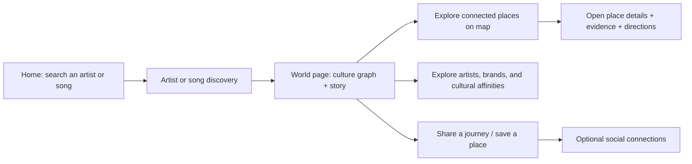
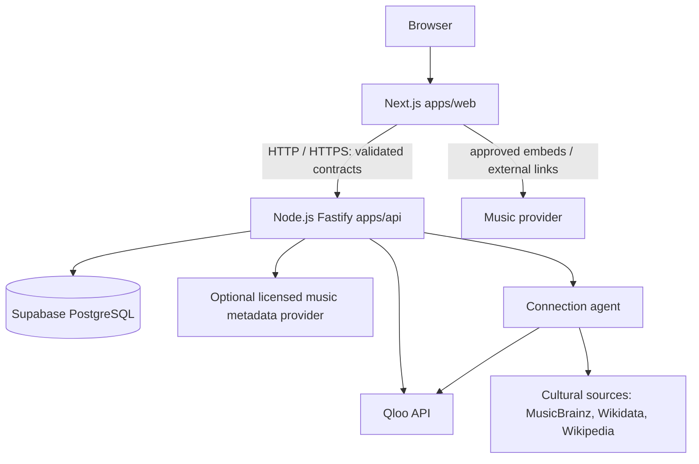

# Worlds.fm 🌍

> **Every song opens a world.**
>
> Search for the music you love. Discover the artists, places, people, brands, and cultural experiences connected to it.

**Project status:** Product and engineering specification; application code is **not yet scaffolded**.  
**Planning baseline:** 17 October 2026 · **Target demo/submission:** 30 October 2026 (verify the organizer's official deadline and submission requirements).  
**Repository visibility:** Private during early development; publish before submission **if required by the hackathon rules**, after a secret scan and open-source/license review.

## What Worlds.fm is

Worlds.fm is a **music-first cultural discovery platform**, not another music streaming service or listening-statistics clone.

Users start with a familiar search for a **song or artist**. The result opens a **World**: an interactive cultural graph with geographic connections, contextual stories, and paths to explore other artists, venues, museums, places, brands, and experiences. An interactive map is our **signature exploration interface**, but search is the primary entry point. A social layer eventually helps fans share journeys and meet people with overlapping *self-declared* tastes.

**Positioning:** Spotify helps people listen. Music-statistics apps help people understand listening habits. **Worlds.fm helps people explore the world connected to music.**

### Design principles

1. **Search-first, exploration-driven.** The first useful action is searching an artist or song; the map and cultural graph are visible and central once the journey begins.
2. **Discoverable, not speculative.** Distinguish sourced historical links from model-generated summaries, Qloo affinities, and community reports.
3. **Map-worthy experiences.** Museums, recording sites, venues, festivals, artist-affiliated businesses, and meaningful cultural locations can become map nodes when location data and provenance exist.
4. **Social by choice.** Profiles, shared links, following, and activity are opt-in. Defaults must not expose personal listening, precise location, or private information.
5. **Legal music access.** Use permitted embeds and links, not downloaded or pirated audio.
6. **One clean codebase.** Next.js frontend; separate Node.js/Fastify API from day one; shared contracts; one monorepo and one primary integration branch.

## The core product journey



**First impression:** Dark, immersive homepage with a prominent artist/song search, a subtle globe or geographic motif, and editorially curated example journeys. The map must be accessible from primary navigation; it should never feel like a hidden feature.

### Example: Avicii

A fan searches **Avicii** and enters his World. They can discover the **Avicii Experience in Stockholm** as a sourced real-world destination, read a concise explanation of the relationship, view it on the map, and explore clearly labeled Qloo affinities to other cultural entities. This example is an editorial seed: verify source details and coordinates before displaying them as facts.

### Example: Rihanna

A user explores **Rihanna** and can see a documented artist-to-brand relationship to **Fenty Beauty**, provided it is sourced and described precisely. **Artist-founded brand** is a historical/business relationship; it must **not** be shown as evidence that any particular song created that brand.

### Example: a fan party inspired by a song

A future user can propose an event with a title, date, venue, song association, and evidence. Worlds.fm can moderate and publish that as a **community-reported event**. **Qloo is not an event ledger or a causal-history verifier.** This feature is *post-MVP* unless the core experience is already stable.

## Cultural graph and provenance

Worlds.fm stores its own relationships, with a visible provenance label on each edge and a source link where available.

| Relationship class | Example | Where it comes from | UI label |
|---|---|---|---|
| `verified` | Artist → documented museum or founded brand | Trusted external sources reviewed by an editor | **Verified connection** |
| `affinity` | Artist → associated destination, place, or brand | Qloo Insights API | **Cultural affinity** |
| `community` | Song → fan-organized party | User report + review status | **Community report** |
| `editorial` | Curated thematic cultural journey | Editor-authored interpretation with supporting citations | **Editorial perspective** |

**Non-negotiable:** Qloo affinities represent recommendation/association signals, **not proof of historical contact, ownership, inspiration, causation, or events**. Never convert a recommendation score into “this song caused this party,” and never create a specific relationship without a cited basis. AI may draft plain-language explanations only from supplied facts and must not fabricate citations.

Suggested future tables (final names and constraints should be agreed before migrations):

- `entities`: stable IDs, type (`artist`, `song`, `place`, `brand`, `event`, etc.), name, metadata, coordinates if applicable.
- `connections`: from/to entity IDs, relationship type, strength where meaningful, provenance class, review status.
- `sources`: URL, title, publisher, fetched/reviewed timestamps, evidence notes; connect to relationships.
- `journeys`: curated or user-created paths through connected nodes, including share visibility.
- `profiles`, `follows`, `saved_items`, `activity`: later social layer; privacy-first and independent of restricted platform listening histories.

Use Postgres constraints and migrations; do not duplicate unrelated provider IDs as the canonical entity key. Source data may need periodic refresh and deletion workflows.

## What Qloo does — and does not do

Qloo is the **cultural affinity/recommendation engine** used by our backend. Its published API supports entities such as `artist`, `brand`, `place`, and `destination`, plus geographic analyses. Use Entity Search to resolve supported IDs and Insights to request relevant recommendations. Always verify the exact supported fields, entitlements, response shapes, and rate limits against the live documentation before implementation.

**Important boundary:** Qloo's published Insights entity-type list does **not** list individual songs or user-created events as first-class output categories. Song search/metadata requires another authorized source or a small licensed/editorial catalog; user-submitted events belong in Worlds.fm's own database. This is a product design boundary, not a workaround to misrepresent Qloo results.

Backend flow: resolve entity → request supported Qloo insights → validate/normalize → attach `affinity` provenance → cache if permitted → return a stable internal API contract. Gracefully handle missing entities, unavailable categories, empty results, and API downtime. Never send a Qloo API key to the browser.

Official references: [Qloo API overview](https://github.com/qloo/docs-public/blob/main/reference/api-overview.md) · [Insights parameters/categories](https://github.com/qloo/docs-public/blob/main/reference/insights-api-deep-dive.md).

## Audio, links, and listening

Worlds.fm does **not** host, pirate, redistribute, or automatically play copyrighted music files. The planned MVP can link out to authorized listening services and, where allowed, present **provider-controlled embeds**, subject to the provider's display, branding, availability, and playback restrictions. Playback may vary by platform, account, and region.

**Do not** build user matching, behavioral scoring, analytics, or AI training from Spotify content or Spotify listening activity. Spotify's developer policy currently restricts these uses. For the social MVP, use **voluntarily selected favorite artists**, saved Worlds, or explicit user actions **inside Worlds.fm**, as permitted by law and any applicable provider agreements. Do not upload, index, stream, or sync a visitor's local music library: local file access is not a shortcut around music licensing.

Spotify reference: [Embeds](https://developer.spotify.com/documentation/embeds) · [Developer Policy](https://developer.spotify.com/policy). Review applicable terms before adding an integration.

## Social vision: the Taste Passport

Long-term, the **Taste Passport** profile lets a user choose favorite music, display saved Worlds, follow others, publish shareable journeys, and find people with overlapping selected tastes. Inspired by gaming-platform activity feeds, **activity sharing is opt-in** and user-controlled; visibility options, reporting/blocking, and anti-spam moderation are necessary before broader rollout.

**MVP:** A journey with a copyable, permission-aware URL and, if capacity permits, a minimal public profile with user-controlled display name and selected interests.  
**Stretch:** Follow, saved places, privacy controls, simple feed, likes, and friend discovery based on self-declared interests.  
**Later:** User-submitted events, attendance coordination, deeper matching, messaging, personalized notifications.

**Never** expose precise location, live listening, or a person's activity without explicit consent. Avoid building a minors-targeted social/matching product during the hackathon.

## MVP scope and acceptance criteria

**Target for 30 October:** A polished, coherent vertical slice, not a vast network of empty screens.

| Priority | Experience | Minimum evidence of completion |
|---|---|---|
| P0 | Search | A user can find at least one supported artist from an authorized, documented dataset or provider. Song search can be included only with a lawful metadata source. |
| P0 | Artist World | World page shows a short grounded overview and cultural connections with visible type/provenance. |
| P0 | Qloo integration | A real backend Qloo request succeeds; a genuine affinity appears in the UI or a clearly marked offline demo fallback. |
| P0 | World map | At least one sourced, geocoded destination opens a detail panel with attribution and external directions. |
| P0 | Share | A working deep link opens the same public World or journey; private data is never leaked. |
| P0 | Repository + deployment | Web and API run independently, are linked via API, and have reproducible setup instructions. |
| P1 | Music playback | Authorized provider embed or external playback link works in at least one demonstrated flow. |
| P1 | Taste Passport | Simple opt-in profile showing manually selected favorite artist(s) or saved World(s). |
| P2 | Social feed + following | Only after P0 works; include visibility controls. |
| P2 | Event submissions + matching | Moderation and user safety requirements must be met; do not block MVP. |

Demonstrate the **difference** between a verified historical relationship and a Qloo affinity in the same World. If an integration cannot be completed, use visibly labeled mock data only in development/demo mode and describe that limitation in the submission.

## Technical architecture

**Decided stack**

| Layer | Choice | Ownership |
|---|---|---|
| Web client | **Next.js + TypeScript** | `apps/web` — UI, accessible pages, navigation, public embeds |
| API | **Node.js + Fastify + TypeScript** | `apps/api` — business logic, data access, provider calls, auth verification |
| Data | **Supabase-hosted PostgreSQL** | Database; migrations in `supabase/migrations` |
| Contracts | **TypeScript + Zod** (proposed) | `packages/shared` — API request/response schemas and shared types |
| Cultural engine | **Qloo Insights API** | Server-side integration only |
| Connection agent | **Server-side agent + hosted model** | `apps/api` — researches whether a real, sourced connection exists between two nodes; cites it or declines. Rules in AGENTS.md §12 |
| Deployment | Separate web/API services | Separate environment and deploy logs; choose providers during M0 |
| Repository | **GitHub monorepo** | One `main`, temporary task/feature branches |



### Repository layout (target, not yet created)

```text
worlds-fm/
├── apps/
│   ├── web/                       # Next.js frontend ONLY
│   │   └── src/
│   └── api/                       # Fastify backend ONLY
│       └── src/
│           ├── routes/
│           ├── controllers/
│           ├── services/
│           ├── integrations/      # Qloo / optional providers
│           ├── middleware/
│           └── lib/
├── packages/
│   └── shared/                    # Shared types and schemas
├── supabase/
│   └── migrations/                # Reviewed, versioned SQL migrations
├── docs/                          # Architecture, provider contracts, design notes
├── .github/workflows/             # CI (created in M0)
├── .env.example                   # Names only; NO secret values
├── .gitignore
├── AGENTS.md                      # Mandatory instructions for coding agents
├── README.md
├── package.json                   # Workspace scripts (created in M0)
└── pnpm-workspace.yaml            # Workspace declaration (created in M0)
```

### Ownership / deployment contract

- `apps/web` handles presentation, client-state, map rendering, and calls to `apps/api` using the public API URL. **No Qloo keys, database service-role keys, or secret calls in the frontend.** Next.js route handlers must not become a second domain API.
- `apps/api` owns Qloo requests, persistence, validation, provenance, moderation, authorization, and any permitted backend metadata integrations.
- `packages/shared` holds provider-agnostic API types/schemas, not full UI components or privileged server utilities.
- `supabase/migrations` holds versioned, reviewed SQL; the API owns data access. Set up RLS where applicable, and never trust an unverified user-supplied ID.
- **Git branches separate work, not applications.** Never maintain a long-lived “backend” branch and “frontend” branch. Every feature branch starts from current `main` and edits the correct directories.

### Proposed initial API contract (subject to M0 review)

| Endpoint | Responsibility |
|---|---|
| `GET /health` | Health check without external secrets. |
| `GET /api/v1/media/artist?name=` | Artist image discovery with provenance + rights status (implemented; see `docs/backend/media-api.md`). |
| `GET /api/v1/media/album?artist=&title=` | Album artwork discovery with provenance + rights status (implemented; see `docs/backend/media-api.md`). |
| `GET /api/v1/search?q=` | Safe artist discovery; song results only when authorized catalog is integrated. |
| `GET /api/v1/artists/:id/world` | Validated world nodes, relationships, and source/label metadata. |
| `GET /api/v1/artists/:id/affinities` | Normalized Qloo results, with allowed category filters. |
| `GET /api/v1/map/nodes?bbox=` | Bounded, geocoded, publicly shareable nodes. |
| `GET /api/v1/journeys/:slug` | Public shareable journey, after feature is implemented. |

API routes are **targets**, not a claim that existing code implements them. Publish a shared schema before implementing an endpoint on either side. Sanitize search input and use pagination, rate limits, timeouts, and cache controls.

## Visual identity

A **near-black, green-tinted dark foundation with a restrained green palette, but not Spotify branding or copied UI**. Worlds.fm should feel cinematic, geographic, social, and culturally curious. The approved creative direction is [`docs/design/landing-page-blueprint.md`](./docs/design/landing-page-blueprint.md).

| Token | Hex | Purpose |
|---|---|---|
| `night` | `#08120B` | Page background (approved dark background) |
| `electric` | `#00CD37` | Primary action, focus ring, live and verified signals |
| `vibrant` | `#46D35D` | Affinity accents, hover on green elements |
| `fresh` | `#5DDE6C` | Primary action hover |
| `mint` | `#CBF2CD` | Wordmark outline, pull quotes, glass highlights |
| `forest` | `#2A6E4C` | Ambient glow, map land, large decoration only |
| `surface-1` / `surface-2` | `#0E1912` / `#142219` | Raised and elevated panels (derived) |
| `text` / `text-2` / `text-3` | `#EEF6EF` / `#A3B5A8` / `#8AA090` | Primary, secondary, tertiary text (derived) |

Tokens are implemented in `apps/web/src/styles/tokens.css`. **Green means signal:** saturated green marks only what is interactive, live, or verified. Any additional category or status color must be added to `tokens.css` with contrast checked against `night`. Encode relationship types through **labels, line patterns, and icons**, not color alone. Aim for WCAG AA contrast, keyboard-accessible controls, mobile support, and reduced-motion preferences. Do not use generic admin-dashboard styling, gratuitous gradients, or copied Spotify layouts.

## Development bootstrap — M0 tasks

The repo currently contains documentation only unless code has been scaffolded separately. During M0:

1. Initialize a `pnpm` workspace with `apps/web`, `apps/api`, and `packages/shared` under **the same repository**.
2. Set up strict TypeScript, lint/format, workspace scripts, `.gitignore`, `.env.example`, and independent dev/build commands.
3. Implement `GET /health` in Fastify and a Next.js status view that fetches it through `NEXT_PUBLIC_API_BASE_URL`.
4. Configure a private `QLOO_API_KEY` and a backend-only Qloo smoke test using current docs; do not commit keys or fixtures with real personal data.
5. Create database connection, first migration, and simple seeded **verified demo node** with its evidence source.
6. Configure independent preview/deploy services for web and API; test CORS origin allowlist and error/fallback paths.
7. Add CI to run format/lint/typecheck/test/build for affected workspaces.

**Illustrative environment variable names (finalize during scaffold):**

```dotenv
# apps/web/.env.local — PUBLIC URL only
NEXT_PUBLIC_API_BASE_URL=http://localhost:4000

# apps/api/.env — NEVER COMMIT
PORT=4000
CORS_ALLOWED_ORIGIN=http://localhost:3000
# Issued by Qloo; sent as the X-Api-Key header. Never expose to the browser.
QLOO_API_KEY=
QLOO_API_BASE_URL=https://hackathon.api.qloo.com
DATABASE_URL=
# If the API uses Supabase service-role features, store the key on the API only.
SUPABASE_URL=
SUPABASE_SERVICE_ROLE_KEY=
```

Store sample *names* in `.env.example`, not real values. Do not put an API key inside any `NEXT_PUBLIC_` variable. Commands and provider-specific configuration must be added when the apps actually exist.

## Milestones (planning targets)

| Window (2026) | Milestone | Exit gate |
|---|---|---|
| **Oct 17–18** | **M0 — Foundation** | Clean monorepo, separate web/API, health request, Qloo smoke test, CI. |
| **Oct 19–21** | **M1 — Discovery** | Search an artist; render a complete World page. |
| **Oct 22–24** | **M2 — Cultural graph/map** | Display Qloo affinities plus a sourced geographic node, with distinct labels. |
| **Oct 25–27** | **M3 — Share/polish** | Working share links, responsive polish, error states, optional authorized embed. |
| **Oct 28–30** | **M4 — Submission** | Test demo, accessibility/security review, README/screenshots/video, check submission rules, public/open-source readiness as required. |

Protect P0 functionality if late-stage stretch work threatens the demo. Submission rules, exact times, required license, and repo-public requirements must be confirmed against the organizer's official page.

## Repository rules and next steps

All coding agents and contributors must follow **[AGENTS.md](./AGENTS.md)**. Make changes to both files when an architectural decision materially changes. Never mix frontend and backend directories or use separate permanent app branches.

**Next action:** Copy this `README.md` and `AGENTS.md` to the root of the new private GitHub repository, commit together, then begin M0 scaffolding in a short-lived feature branch (or on `main` for this initial empty repo).
